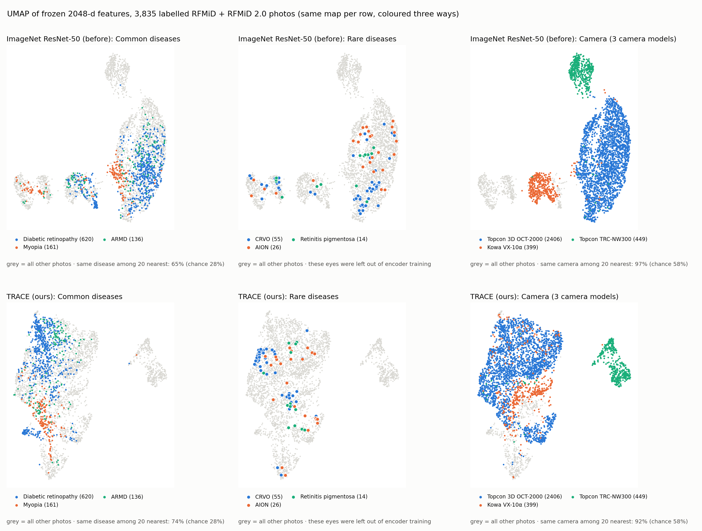
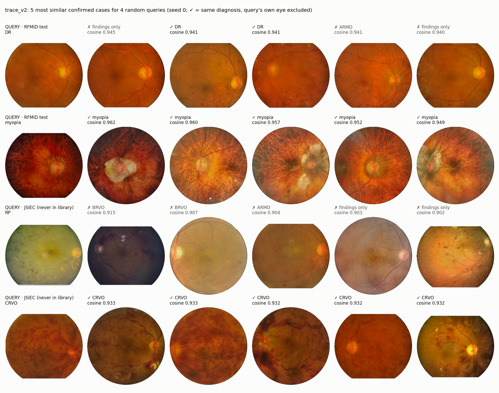
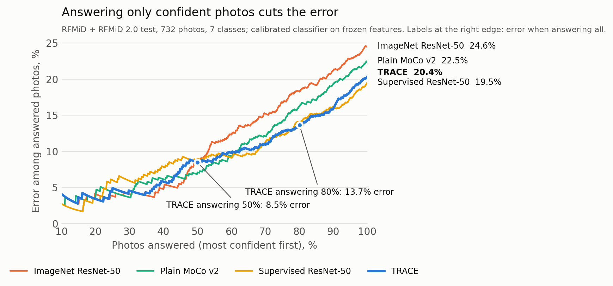

# TRACE: Trustworthy Retinal Contrastive Encoder

> **TRACE learns from less, ignores the camera, and knows when it doesn't know.**

TRACE is a foundation model for **retinal fundus photos**, the colour photos of the back of the eye that
eye doctors use to find diabetic retinopathy, glaucoma, vein blockages and many rarer diseases. It is the entry of
team **div4maxxers** (BMSIT, Bengaluru) for the **ZEISS India Campus Hackathon "Beyond Code 2026", Theme 2:
Contrastive Learning for Rare Eye Diseases**.

**Status (14 Nov 2026):** the encoder is final and frozen; finding detectors, rare-disease bank, trust layer and the
demo app are built and evaluated; the model card is written. **Weights:** [higgsboson25/trace-retinal-encoder](https://huggingface.co/higgsboson25/trace-retinal-encoder) on Hugging Face.
Full results: [MODEL_CARD.md](MODEL_CARD.md). Data: [DATA_CARD.md](DATA_CARD.md).

---

## Contents
1. [Results at a glance](#1-results-at-a-glance)
2. [The problem in plain words](#2-the-problem-in-plain-words)
3. [How TRACE works](#3-how-trace-works)
4. [How the encoder is trained](#4-how-the-encoder-is-trained)
5. [What worked and what did not](#5-what-worked-and-what-did-not)
6. [Data and the no-leakage rules](#6-data-and-the-no-leakage-rules)
7. [Use the trained encoder](#7-use-the-trained-encoder)
8. [Reproduce everything](#8-reproduce-everything)
9. [Repo layout](#9-repo-layout)
10. [Further reading](#10-further-reading)

---

## 1. Results at a glance

The encoder is **frozen** in every test below; only small heads are trained on its 2048-number output.
"ImageNet" is the same ResNet-50 before any training on eye photos. 95% intervals and every other number are in
[MODEL_CARD.md](MODEL_CARD.md).

| Question | Test | ImageNet | Plain MoCo v2 | Supervised ResNet-50¹ | **TRACE** |
|---|---|---|---|---|---|
| Does it transfer? | RFMiD test, 18 labels, linear probe (AUROC) | 0.885 | 0.917 | 0.918 | **0.917** |
| … to a camera it never saw? | Kowa VX-10α held out / Topcon OCT-2000 held out | 0.867 / 0.796 | 0.903 / 0.809 | — ² | **0.921 / 0.858** |
| Few labels, new diseases? | JSIEC-1000, 39 diseases, 5 photos each (top-1) | 0.536 | 0.611 | 0.571 | **0.628** |
| … on a teammate's fixed exam? | 11 rarer RFMiD labels, 5 photos each (AUPRC)³ | 0.169 | 0.226 | — ¹ | **0.264** |
| Robust to poor photos? | 11 corruptions × 5 levels, error vs ImageNet (lower is better) | 1.00 | 0.72 | 0.74 | **0.67** |
| Safe when unsure? | Confidently wrong, RFMiD + RFMiD 2.0 test / rare diseases | | | | **3.3% / 0%** |

¹ Fine-tuned end to end on RFMiD's labels. With its own head it reaches **0.941** on RFMiD test, above TRACE, and it
beats TRACE on DR at a new hospital (Paraguay 0.933 vs 0.886). It was trained on 9 of the 11 exam labels, so it is
not comparable there. ² Its backbone saw labelled photos from every RFMiD camera. ³ Their published DINOv2-S score on
the same episodes: 0.227 (their preprocessing, so not a paired comparison).

**In one line:** labels win on the diseases they cover; TRACE wins on diseases with few labels, on new cameras and on
poor photos, and it refers rather than guesses when it is unsure.

| UMAP: same map, coloured by disease and by camera | 5 most similar past cases (random queries) |
|---|---|
|  |  |



**Knowing when it is unsure:** sorted by its calibrated confidence, TRACE's error falls from 20.4% when it answers
every photo to 13.7% when it answers its most confident 80%, and 8.5% at 50% (area under the curve 0.086; supervised
0.092, plain MoCo 0.094, ImageNet 0.110). The decision rule uses this: unsure photos are short-listed or referred.

---

## 2. The problem in plain words

AI models for eye photos have three well-known weaknesses:

1. **They need lots of labelled photos.** A doctor has to label every training image, and rare diseases have
   only a handful of examples.
2. **They learn the camera, not the eye.** A model trained on one hospital's camera often fails on another,
   because it partly learned "this tint and lighting means disease X". This is called *domain shift*.
3. **They are always confident.** A normal model gives an answer even for a blurry photo, a disease it has never
   seen, or a picture that isn't an eye at all.

ZEISS asked for one reusable encoder that learns from **unlabelled** photos, transfers to new hospitals and
cameras with **few labels**, and is **calibrated, explainable and able to say "I don't know"**.

---

## 3. How TRACE works

### One photo in, one decision out

```
Fundus photo (any camera)
   │
   ▼
Quality gate ──bad photo──► "Please retake the photo"
   │ ok
   ▼
Preprocess (find the retina · even out lighting · tone down a known camera's colour · gentle contrast boost)
   │
   ▼
Encoder (ResNet-50, frozen) ──► 2048-number "fingerprint" of the eye
   │
   ├──► 20 finding detectors (disc edema, haemorrhage, drusen …) ──► evidence for / against each disease
   ├──► Disease classifier + rare-disease bank (AION, CRVO, RP from a few photos each)
   └──► Similar-case search (FAISS) ──► 5 most similar past cases + "is this photo unusual?"
                                │
                                ▼
                Trust layer: unusual? → calibrated scores → conformal prediction set (per camera)
                                │
                                ▼
                 Diagnose  |  Short-list  |  Refer to a specialist
         (shown with the findings, the evidence for and against, and the similar cases)
```

### Rare diseases: what the data told us

Our first plan was **zero-shot**: score a rare disease from its textbook findings with a knowledge graph
("disc swelling + pale disc → AION"), with no photos of it at all. **It failed**: 0 of 30 AION and 0 of 78 CRVO photos
were ranked first, because the finding detectors barely respond to CRVO's signs and one weak finding cannot beat the
prior towards "normal". With **a few photos** it works. At a 5% false-alarm rate, the simple prototype bank that the
decision rule and demo use catches CRVO 57%, AION 37% and RP 36% of the time, and all JSIEC CRVO photos (a dataset it
never saw). A logistic model with distribution calibration, tested separately and not yet in the decision rule, raises
this to CRVO 79%, RP 79%, AION 47%, and 95% of JSIEC's CRVO and RP photos (model card, section 4.2). So rare diseases
are recognised from a few photos, and the knowledge graph is used to **explain** decisions, not to make them.

---

## 4. How the encoder is trained

TRACE starts from the standard ImageNet ResNet-50 and is trained further on **22,500 unlabelled fundus photos**
(EyePACS, APTOS, RFMiD train, RFMiD 2.0 train) with **MoCo v2** contrastive learning: two edited copies of a photo
are pulled together, copies of other photos pushed apart. No labels are used. Training took about 4 GPU-hours on a
laptop RTX 4060 for the final checkpoint.

**Our rule for edits: an edit is allowed only if a doctor would give both copies the same diagnosis.**

| Edit | Standard recipe | TRACE |
|---|---|---|
| Crop | 8–100% of the image | 60–100%, kept inside the retina |
| Colour jitter | strong | gentle (brightness / contrast 0.2, hue 0.02) |
| Grayscale | 20% of the time | **never** (red lesions vanish) |
| Blur | strong | light, 30% of the time (microaneurysms are a few pixels wide) |
| Camera artifacts | none | vignetting, camera colour profiles, haze, glints, eyelash shadows, JPEG |
| Multi-crop | none | 2 large + 4 small views per photo |
| Same-camera negatives | weight 1 | weight 2 (β), so camera cues don't help tell photos apart |

We never add fake dust spots, because they look like microaneurysms. Then 10 more epochs at 384 px for lesion detail.
The checkpoint is always chosen on a validation split (val-A), never on test.

**Cross-camera false-negative mining** (pulling look-alike photos from *different* cameras together) was built,
monitored (attracted pairs share a diagnosis 4.7–5.6× more often than chance) and tested, but it is **not** in the
final encoder: val-A picked the checkpoint from before mining started, and the ablation below shows why.

---

## 5. What worked and what did not

Short-budget ablation (10,000 photos, 30 epochs; full table in `outputs/ablation/table.md`):

| Step added | Effect |
|---|---|
| Retina-safe views | **Helps:** unseen-camera AUROC 0.819 → 0.848, new hospital (Paraguay) 0.910 → 0.935 |
| Same-camera negatives ×2 | Fewer same-camera neighbours (0.929 → 0.907); nothing else moves |
| Multi-crop | Lowers few-shot (JSIEC 5-shot 0.635 → 0.594) |
| Cross-camera mining | Mixes cameras most (0.907 → 0.868) but costs few-shot (0.600 → 0.520) and IDRiD (0.880 → 0.845) |
| A teammate's lesion-guided small crops (in place of multi-crop) | Lowers few-shot further (0.550) and makes neighbours more camera-driven; not adopted |

Other honest results:
- **Camera identity is still visible** in every encoder's features (a probe tells RFMiD's 3 cameras apart at ~0.99).
  What TRACE reduces is how much the camera *matters*: smaller drops on unseen cameras, fewer same-camera neighbours.
- **New sites need recalibration.** At Paraguay the conformal coverage falls from 90% to 58%; ~100 local photos
  restore it to 90%.
- **LoRA** (1.1% of the weights, encoder otherwise frozen) lifts RFMiD from 0.917 to 0.932 with all labels, close to
  full fine-tuning (0.941).

---

## 6. Data and the no-leakage rules

| Dataset | Photos | Used for |
|---|---|---|
| RFMiD (provided by ZEISS) | 3,200 | Pretraining (train split, labels hidden), finding labels, validation, held-out test |
| RFMiD 2.0 | 860 | Same as RFMiD; extra rare diseases |
| EyePACS (Kaggle 2015) | 35,108 | Pretraining pool (16,918 quality-filtered), labels ignored |
| EyeQ | 12,543 grades | Photo-quality labels for EyePACS (quality gate) |
| APTOS 2019 | 3,662 | Pretraining pool, labels ignored |
| IDRiD | 516 + 81 | **Held-out test**: DR grading, lesion masks |
| JSIEC-1000 | 1,000 | **Held-out test**: 39 classes, rare diseases, unfamiliar photos |
| Paraguay DR | 1,437 | **Held-out test**: unseen site on a ZEISS VISUCAM 500 |

**Photos are not included in this repo.** Each dataset must be downloaded from its own source under its own terms;
see [DATA_CARD.md](DATA_CARD.md).

**Leakage rules we never break:**
- Every photo is compared with every other for duplicates and same-eye copies (matched on fine vessel detail).
  2,039 photos were dropped. A copy of a test photo never enters training. **84 RFMiD photos are IDRiD photos**
  (60 exact copies; 69 in RFMiD train or val), so "pretrain on RFMiD, test on IDRiD" leaks unless they are removed; we remove them.
  A teammate's independent duplicate list (143 pairs) found no pair we missed.
- Splits keep the same eye together.
- Validation is split in two: **val-A** tunes settings, **val-B** sets the conformal threshold.
- **Leave-disease-out:** AION, CRVO and RP photos are removed from everything, including the unlabelled pool.
- Test sets are used only for evaluation.

---

## 7. Use the trained encoder

**Weights:** on Hugging Face at [higgsboson25/trace-retinal-encoder](https://huggingface.co/higgsboson25/trace-retinal-encoder): `encoder.pt` (94 MB, ResNet-50
backbone) plus the heads and trust files the demo needs (102 MB). No login needed; from the repo folder run

```bash
huggingface-cli download higgsboson25/trace-retinal-encoder --local-dir .   # -> checkpoints/trace_v2/, artifacts/trace_v2/
```
Research use only (see the model card). The camera colour statistics (`data/trace_preprocess.json`)
are in the repo. On a laptop CPU one photo takes about 0.3 s to preprocess and 0.15 s to encode.

### Embed a folder of photos (one command)

```bash
python -m encoder.embed --images path/to/photos --out features.npy               # unknown camera (default)
python -m encoder.embed --images path/to/photos --out features.npy --camera kowa_vx10a   # a camera TRACE knows
```
It finds every `.jpg/.jpeg/.png/.tif/.tiff/.bmp` under the folder (recursively), applies TRACE's evaluation
preprocessing and writes `features.npy` (float32, N × 2048, L2-normalised, so cosine = dot product) plus
`features_index.csv` (row, path, ok, error). A photo where no retina is found gets a row of zeros and `ok = False`, so
rows always line up with the file list. GPU if available, else CPU (about 6 photos/s with 4 preprocessing workers,
on full-size 4288 × 2848 photos). On real test photos its features match the ones behind every result in the model
card (cosine 1.00000). Known camera ids: `topcon_3d_oct2000`, `kowa_vx10a`, `topcon_trc_nw300`, `rfmid2_512x512`,
`rfmid2_1504x1000`, `aptos`, `eyepacs`; for any other camera leave `--camera` out.

### From Python

```python
import cv2
from encoder.export import load_trace_encoder, preprocess

enc = load_trace_encoder("checkpoints/trace_v2/encoder.pt")               # CPU is fine
photo = cv2.cvtColor(cv2.imread("fundus.jpg"), cv2.COLOR_BGR2RGB)
x = preprocess(photo, source_id=None, stats_path="data/trace_preprocess.json")  # (3, 384, 384) in [0, 1]
features = enc(x[None])                                                   # (1, 2048), L2-normalised
```
`source_id` names a known camera (e.g. `"kowa_vx10a"`) to apply its colour correction; `None` (unknown camera) skips
it. `preprocess` raises `ValueError` if no retina is found.

### The demo app

```bash
python -m demo.app        # open http://127.0.0.1:7860 (needs the Hugging Face download above)
```
Upload a fundus photo and get the decision card: **diagnose / short-list / refer / retake**, with the reason, the
quality, familiarity and rare-disease checks, the 90% conformal set, the calibrated findings, the evidence for and
against from the knowledge graph, and the 5 most similar confirmed cases. About 1 s per photo on a laptop CPU.
It needs `checkpoints/trace_v2/encoder.pt` and the files in `artifacts/trace_v2/` (in the same download); the
similar-case thumbnails appear only if you have built `processed/` yourself, because the photos cannot be redistributed.
The demo reproduces the evaluation exactly: on all 787 RFMiD + RFMiD 2.0 test photos it makes the same decisions as
`eval/decision_eval.py` (one photo differs, fp32 vs fp16 rounding); check with `python -m demo.check_pipeline`.

---

## 8. Reproduce everything

### Setup
```bash
git clone https://github.com/nithinj25/zesis-contrastive-learning.git
cd zesis-contrastive-learning
python -m venv .venv
# Windows:  .venv\Scripts\activate      Linux/Mac:  source .venv/bin/activate
pip install torch torchvision --index-url https://download.pytorch.org/whl/cu121   # match your CUDA
pip install -r requirements.txt
pytest -q                     # 234 tests
```

### Put the datasets in `raw/`
```
raw/
├── rfmid/      Training_Set/…, Evaluation_Set/…, Test_Set/…   (as unzipped from IEEE DataPort)
├── rfmid2/     Training_set/, Validation_set/, Test_set/
├── eyepacs/    resized_train_cropped/resized_train_cropped/*.jpeg + trainLabels_cropped.csv
├── eyeq/       Label_EyeQ_train.csv
├── aptos/      train_images/train_images/, … + train_1.csv, valid.csv, test.csv
├── idrid/      A. Segmentation/, B. Disease Grading/, C. Localization/
├── jsiec/      1000images/<class folders>/
└── paraguay/   <grade folders>/ + "Annotations of the classifications.xlsx"
```
A missing dataset is skipped with a message. Exact paths are at the top of [data/ingest.py](data/ingest.py).

### One command per stage
`make help` lists them. Without `make` (Windows), run the commands in the [Makefile](Makefile) by hand, in order.

| Command | What | Time (RTX 4060 Laptop) |
|---|---|---|
| `make data` | raw photos → `data/meta.parquet` + 512 px processed photos | ~1 h (CPU) |
| `make pretrain` | the TRACE encoder (224 px, then 384 px) → `checkpoints/trace_v2/encoder.pt` | ~12 h (GPU) |
| `make baselines` | plain MoCo v2 and the supervised ResNet-50, plus ImageNet features | ~2 h |
| `make features ENC=trace_v2` | frozen features (+ disc / macula crops) of every photo | ~10 min |
| `make heads` | finding detectors and the rare-disease bank | minutes |
| `make trust` | classifier, calibration, per-camera conformal sets, OOD index, quality gate | minutes |
| `make demo` | build the demo files (`findings.export`, `demo.bundle`) and start the demo | ~2 min |
| `make embed IMAGES=… OUT=…` | features of any folder of photos (section 7) | ~6 photos/s (CPU) |
| `make eval` | every result in the model card | ~1–2 h (CPU) |
| `make figures` | UMAP and the disease × finding map | minutes |
| `make test` | unit tests | ~1 min |

Any training setting can be overridden on the command line (Hydra), e.g. `train.workers=8 optim.epochs=30`.
Training saves a resumable checkpoint every 300 steps: `python -m encoder.train ckpt.resume=checkpoints/trace_v1/last.pt`.
On Windows, keep loader workers modest (8 on 16 GB RAM) and close other heavy apps during long runs.

---

## 9. Repo layout

```
zesis/
├── CLAUDE.md            # full design spec + dated decision log (the "source of truth")
├── MODEL_CARD.md        # what TRACE is for, every result, known failure modes
├── DATA_CARD.md         # every dataset, licence, counts, cleaning, known problems
├── Makefile             # one command per stage
├── configs/             # Hydra configs: data, pretraining (224 / 384 px), ablation ladder
├── data/                # ingest, dedupe, preprocess, quality, ontology, splits
├── augment/             # retina-safe views, artifact simulator, torch-free multi-process loader
├── encoder/             # MoCo, TRACE loss, training loop, export, feature cache, supervised baseline, LoRA
├── findings/            # disc / macula localiser and crops, finding detectors
├── graph/               # knowledge-graph edges (cited), evidence scorer, rare-disease bank, distribution calibration
├── trust/               # quality gate, calibration, OOD, conformal sets, decision rule
├── eval/                # every evaluation in the model card
├── scripts/             # audits, contact sheets, ablation queue, figures
├── docs/                # data pipeline walkthrough, figures
├── demo/                # Gradio demo: one-photo pipeline, demo bundle, app
└── tests/               # 234 unit tests (pytest)
```

Not in git (too big, or not ours to share): `raw/`, `processed/`, `features/`, `checkpoints/`, `artifacts/`,
`outputs/`, and all `*.parquet`, `*.npy` and `*.pt` files.

The teammates' approaches and the code that ports their evaluation protocols (fixed few-shot exam, stress test,
duplicate cross-check, lesion-guided crops) are on the branch **`combined`**; the encoder on this branch is unchanged
by them.

---

## 10. Further reading

| Read | What it covers |
|---|---|
| [MODEL_CARD.md](MODEL_CARD.md) | Intended use, all results with intervals, failure modes, compute |
| [DATA_CARD.md](DATA_CARD.md) | Datasets, licences, cleaning numbers, known issues |
| [CLAUDE.md](CLAUDE.md) | The complete design: every decision, formula, worked example and the dated decision log (§20) |
| [docs/DATA_PIPELINE.md](docs/DATA_PIPELINE.md) | The data pipeline step by step |

**Built on:** MoCo v2 (He et al. 2019; Chen et al. 2020), SimCLR (Chen et al. 2020), alignment and uniformity
(Wang & Isola 2020), distribution calibration (Yang et al. 2021), LoRA (Hu et al. 2021), conformal prediction, and the
HPO frequency annotations for the knowledge graph.

---

*Research prototype for a hackathon. **Not a medical device**, and not for diagnosing real patients.*
*Code: MIT licence ([LICENSE](LICENSE)). Weights: research use only.*
