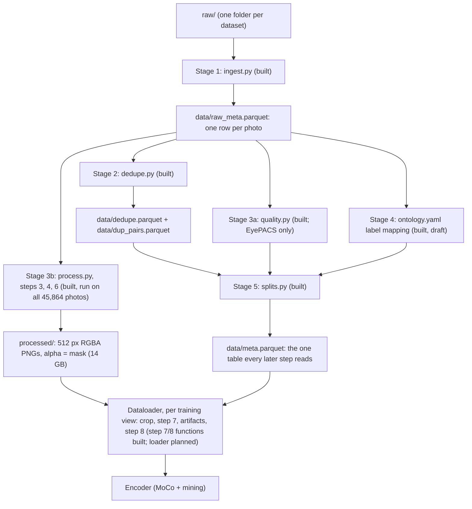

# TRACE data pipeline

How a fundus photo goes from a downloaded folder to a training view the encoder sees.
Status as of 2026-11-06 (Phase 1 complete). **Built** = code, tests and a real-data run exist. **Planned** = specified in
[CLAUDE.md](../CLAUDE.md) but not written yet. All numbers below come from real runs unless marked otherwise.

---

## 1. The two goals behind every step

1. **Camera signal down, biology intact.** The encoder must learn what the eye looks like, not which camera
   or hospital took the photo. So we remove camera differences (size, stretch, lighting, colour tint), but
   never anything a doctor would use (a pale disc, red haemorrhages, tiny microaneurysms).
2. **No leakage, ever.** A photo used for testing must never appear, even as a copy, in anything the
   model learned from. Public fundus datasets copy each other, so this needs real work (section 4).

---

## 2. The big picture



Three ideas to hold on to:

- **One table drives everything.** Every later script reads `meta.parquet` (built from the tables
  above), never folder names. A photo's dataset, split, camera group, labels and quality all live in its row.
- **Expensive work is done once, offline.** Finding the retina and fixing geometry and lighting run once per
  photo and are saved at 512 px.
- **Random work is done per view, on the fly.** Camera colour, augmentations and CLAHE change every time a
  photo is loaded, so the encoder never sees the same view twice. Nothing random is saved to disk.

---

## 3. The datasets and their jobs

| Dataset | Photos (kept after dedupe) | Split we give it | Job |
|---|---|---|---|
| RFMiD | train 1,786 · val 610 · test 639 | train / val / test | Labels for finding probes; val becomes val-A / val-B; test held out |
| RFMiD 2.0 | train 474 · val 168 · test 171 | train / val / test | Extra rare-disease labels, same rules as RFMiD |
| APTOS 2019 | 3,469 | pool | Pretraining only, labels ignored |
| EyePACS (cropped) | 34,058 | pool | Pretraining only; a subset is used (section 8). 12,529 have EyeQ quality grades |
| JSIEC | 993 | test | Held out: rare diseases, unseen-disease and OOD tests |
| IDRiD (grading) | 508 | test | Held out: DR transfer test, named by ZEISS |
| IDRiD (lesion masks) | 81 | test | Held out: "lesions are kept" and explanation tests |
| Paraguay | 1,234 | test | Held out: unseen site on a ZEISS camera (203 same-eye copies dropped) |
| REFUGE | downloading | test | Held out: glaucoma |
| ODIR | not downloaded | pool | Optional extra pretraining data |

**Split ranks.** A held-out set is protected from everything ranked below it:
`test (2) > val (1) > train = pool (0)`. "Pool" means pretraining only: never used to train a head or to calibrate.

---

## 4. Stage 1: ingest (`data/ingest.py`, built)

**What it does:** walks every dataset folder and writes one row per photo into `data/raw_meta.parquet`.
It reads only file headers (size) and label files, so it takes about 50 seconds for 44,427 photos.

**One row looks like this** (a real RFMiD 2.0 photo):

| Column | Value | Meaning |
|---|---|---|
| `image_id` | `rfmid2_train_1` | Unique. IDs restart in every split, so the split is part of the name |
| `path` | `rfmid2/Training_set/1.jpg` | Relative to `raw/` |
| `dataset`, `split` | `rfmid2`, `train` | |
| `width`, `height`, `size_group` | 512, 512, `512x512` | |
| `source` | `rfmid2_512x512` | Camera ID for the mining loss (below) |
| `labels`, `label_ok` | `['HR', 'MCA']`, True | Labels as the dataset names them (mapped later, stage 4) |
| `disease_risk`, `patient` | 1, None | `patient` exists only for EyePACS |

Some datasets add columns: IDRiD has `od_x, od_y, fovea_x, fovea_y` (hand-marked disc and fovea centres),
EyePACS has `patient`, `laterality`, `eyeq_quality`, APTOS has `aptos_split`.

**Rules it follows, and why:**

- **Never guess a label.** RFMiD 2.0 has 6 photos whose ID has no label row (and 6 label rows with no photo).
  They look like typos (image 251, label row 151), but matching them by guesswork could attach the wrong
  disease to an eye. So those photos get `label_ok = False` and are left out of anything labelled.
- **Never guess a camera.** `source` is a real camera only where the data proves it: RFMiD's three image sizes
  are three known cameras (2144×1424 = Topcon 3D OCT-2000, 4288×2848 = Kowa VX-10α, 2048×1536 = Topcon
  TRC-NW300). Otherwise one source per dataset (APTOS, EyePACS, IDRiD) or a size group (RFMiD 2.0, JSIEC).
  Why it matters: the mining loss treats two photos with different sources as "different cameras". Calling
  one camera two names would let it pull same-camera photos together, which teaches camera bias, the exact
  thing we are fighting. The pseudo-domain step (planned, section 10) refines this.
- **Read each photo once.** IDRiD part C's photos are byte-identical to part B's, so C only adds the disc and
  fovea coordinates. EyePACS comes in "resized" and "cropped" versions of the same photos; we use only
  "cropped", which keeps about 50% more fine detail (measured on 60 photos, 59 favoured cropped).

---

## 5. Stage 2: deduplication (`data/dedupe.py`, built)

### 5.1 The problem
If a test photo has a copy in the training data, the test score is fake. Public datasets copy each other:
we found **84 RFMiD photos that are IDRiD photos** (76 exact copies), 72 of them in RFMiD *train*. ZEISS's own
plan (pretrain on RFMiD, test on IDRiD) would leak these.

### 5.2 Why the usual tool failed
The usual tool is a perceptual hash (pHash). On the 4,060 RFMiD and RFMiD 2.0 photos it called **6,863 pairs**
near-identical (Hamming distance ≤ 4), nearly all of them different eyes, because every photo has the same black border, a bright disc on one side and a dark macula in the middle.
pHash sees layout, and every fundus photo has the same layout.

### 5.3 What we compare instead: the vessel pattern
Every eye's vessel tree is unique, like a fingerprint. So each photo is first standardised (stage 3, steps 3
and 4) and then reduced to its **fine detail** with a band-pass filter:

```
detail = blur(green, small sigma) - blur(green, large sigma)
```

The small blur removes pixel noise; subtracting the large blur removes overall brightness, colour and
vignetting. What is left is vessels and lesions (panel 5 of the figure in section 11).

Two signatures per photo:

| Signature | How | Size | Used for |
|---|---|---|---|
| Coarse | Green channel at 64×64, detail (σ 0.8 − 4.0), central circle only, unit length | 2,164 numbers | Fast search: inner product = correlation |
| Fine | Green channel at 256×256, detail (σ 1.0 − 6.0), central 144×144 crop | 144×144 | Exact check: best correlation over small shifts |

**Real example** (photo `rfmid2_train_1`): against a darker, slightly blurred copy of itself the coarse
similarity is 1.00 and the fine score 1.00; against a different eye (`rfmid2_train_104`) they are 0.41 and 0.11.

### 5.4 Searching 44,427 photos without comparing every pair
All pairs would be ~987 million comparisons. So it runs in two steps:

1. **Shortlist on the GPU.** For each photo that needs protecting, take its closest neighbours by coarse
   similarity, **inside each dataset separately**: 50 per dataset, 150 in a dataset over 5,000 photos. Keep
   pairs with coarse similarity ≥ 0.7.
2. **Exact check on the CPU.** For each shortlisted pair, slide the central 128×128 of one fine signature
   over the other, ±8 px each way (17 × 17 = 289 positions), both directions, and take the best correlation.
   This forgives small shifts between two photos of the same eye.

Two choices in step 1 came from real failures:

- **Per dataset, not overall.** With one overall top-30, the 3,662 APTOS look-alikes pushed a real RFMiD
  copy out of the list (47 strong pairs fell to 46). A test now reproduces this.
- **Only photos that need protecting search** (test, val, and RFMiD train for grouping). Pool photos are found
  by them. A pool-vs-pool pair can never cause a drop, and skipping those saves millions of comparisons.
  The cost, measured against the earlier full search: 3 APTOS photos whose only matches were weak
  (0.60–0.68, mostly look-alikes) are no longer caught. No strong pair was lost.

Result: 197,520 pairs checked in 12.5 minutes (6 CPU workers).

### 5.5 What the score means (from looking at contact sheets)

| Score | What it usually is | What we do |
|---|---|---|
| ≥ 0.8 | The same eye (1 of 8 sampled was a false match) | Same-eye group; drop to protect held-out splits |
| 0.6 – 0.8 | Mostly different eyes with a similar look | Still drop if it touches a held-out split (cautious, cheap) |
| < 0.6 | Different eyes | Nothing |

### 5.6 The drop rules

| Pair | Rule | Example |
|---|---|---|
| Different split ranks, score ≥ 0.6 | The lower-ranked photo is dropped | RFMiD train copy of an IDRiD test photo → train copy dropped (`matches_test`) |
| Same split, same dataset, held out, ≥ 0.8 | One copy dropped, or it is counted twice in one test | JSIEC had 7 copies in its folders (`copy_within_test`) |
| Two different test sets, ≥ 0.8 | Both kept, linked by `dup_group` | IDRiD grading vs IDRiD lesion masks: needed in different tests |
| Two training-only photos | Both kept | Train copies don't leak |

`dup_group` is a same-eye group number (if A matches B and B matches C, all three share it). Later it keeps
same-eye photos on one side of val-A / val-B and of cross-validation folds, and lets pooled counts take each eye once.

**Result:** 1,470 of 44,427 photos dropped (EyePACS 1,050, APTOS 193, RFMiD train 134, RFMiD val 30, small
numbers elsewhere). After the drops, **no kept photo matches a kept photo of another split rank**. One rare-disease
photo was lost: an RFMiD *train* CRVO photo that is the same eye as an IDRiD test photo, which IDRiD calls
proliferative DR. Labels can disagree across datasets.

Check it yourself: `python scripts/dedupe_audit.py` prints all of this and writes a contact sheet.

---

## 6. Stage 3: preprocessing, one photo at a time (`data/preprocess.py`)

The traced photo is `rfmid2_train_1`: a 512×512 photo that was really a 4:3 photo squeezed into a square,
so the retina is a tall oval. 61% of RFMiD 2.0's training photos look like this.

### Step 3: find the retina (built)
**Why it is hard:** you can't just keep "bright pixels". A diseased or dim retina can be as dark as the black
background, so a brightness mask cuts holes in the retina (we saw this happen on real photos).

**How:**
1. Blur the red channel slightly (the retina is brightest in red).
2. Pick a threshold between the background (corners) and the retina (centre):
   `threshold = max(0.06 × max, corners + max(8, 0.10 × (centre − corners)))`.
   Traced photo: max 254.8, corners 17.8, centre 107.2 → `max(15.3, 17.8 + max(8, 8.9)) = 26.7`.
3. Keep pixels above it, clean small specks (15×15 opening), take the largest blob's outline.
   This outline is rough: panel 2 of the figure has a dark bite on the left where dim retina fell below 26.7.
4. Fit an **axis-aligned ellipse** to the outline with **RANSAC**: try 400 random ellipses through 4 outline
   points, keep the one most points agree with, then refine it on those points. The bite disagrees with the
   ellipse, so it is ignored instead of pulling the edge inwards.
5. **The mask comes from the ellipse, not from brightness**, so nothing inside the retina is ever cut. Only a
   real flat cut at the top or bottom (a sudden jump from no retina to a wide row) is removed.

Traced photo: centre (256.0, 256.6), rx 255.3, ry 335.9, **ry/rx = 1.316** (stretched), fit 0.68.
`fit` is the share of outline points on the ellipse; it is low here because of the bite and the flat cuts,
which is normal for this group. Failure (no blob, no ellipse, radius under 25% of the width) means `fov_fail`.
Real failure rates: 0 of 8,722 RFMiD/RFMiD 2.0/APTOS/JSIEC photos; 2 of 35,108 EyePACS.

### Step 4: standardise geometry (built)
Crop the ellipse's bounding box and resize it to 512×512. Because the box is rx × ry, this maps the ellipse
to a circle and undoes the stretch.

Traced photo: the crop is 511 × 672 px; horizontal scale 1.003, vertical 0.762, so the tall oval becomes a
circle. The mask covers 67.8% of the square (a full circle is 78.5%; the rest is the flat cuts).
A normal RFMiD photo (`rfmid_train_1`, 2144×1424): ry/rx 1.000, crop 1396 × 1396, scale 0.367 both ways,
mask 78.4%.

Why 512 px for the retina diameter: a lesion is then about the same number of pixels whatever the camera,
so "a microaneurysm is a few pixels wide" means the same thing everywhere. There is no left/right flip here;
training already flips 50% of views.

### Step 5: quality tags (built, `data/quality.py`; EyePACS only)
Simple measurements (sharpness, fine detail, exposure, contrast, dark and bright pixel share, centre-vs-rim
brightness) feed a depth-3 decision tree fitted to EyeQ's human grades on 12,527 EyePACS photos. On held-out
patients it is right 75–78% of the time. The plan was to apply it everywhere, but it called 33% of RFMiD and
61% of Paraguay "reject", and many of those were readable, some with clear lesions or media haze (itself an
RFMiD label): its sharpness threshold depends on each camera's resolution. So it only decides which EyePACS
photos enter the pool (human EyeQ grades first); every other dataset stays `ungraded`. Rejects are kept, out
of the pool, for the quality gate and OOD tests.

### Step 6: fix the lighting (built)
Photos are often bright in the middle and dark at the rim (vignetting). This flattens slow brightness changes
in the LAB L channel only, so colour, which is evidence (pallor, exudates), is untouched.

```
bg      = blur(L × mask) / blur(mask)          (sigma = 64 px; dividing by the blurred mask stops the black border darkening the edges)
L_flat  = L / bg × mean(L inside the retina)
L_out   = 0.4 × L + 0.6 × L_flat               (strength 0.6: partly corrected, never fully flattened)
```

Dry run (mean L = 80, verified by running it):

| Pixel | L | bg | L_flat | L_out |
|---|---|---|---|---|
| Dim rim | 40 | 40 | 80.0 | **64.0** (brighter) |
| Optic disc | 200 | 100 | 160.0 | **176.0** (still much brighter than its surroundings) |

The disc stays bright because sigma = 64 px is much wider than a disc (~80 px), so the background estimate
barely "sees" it. With sigma 32 px, a third of the disc's contrast was lost on real photos; that is why we use 64.
Traced photo: centre-vs-rim gap in L went from 53.4 to 32.1.

**After step 6, the photo and its mask are saved to `processed/`.** Steps 7 and 8 happen later, per view.

### Step 7: camera colour (function built: `camera_color`; applied per training view by the loader, planned)
Each camera has a tint. We shift each **camera's** average LAB colour towards the pool average:

```
mapped = (x − camera_mean) / camera_std × pool_std + pool_mean
out    = 0.3 × x + 0.7 × mapped
```

Dry run on L (camera mean 60, std 20; pool mean 70, std 25; verified): a pale disc pixel at 80 becomes 90.5,
its neighbour at 60 becomes 67.0. The gap grows from 20 to 23.5 (× 1.175), so **the disc stays paler than its
neighbours**. That is the point of using one set of statistics per camera: per-image normalisation would
shift a whole pale eye back to "average" and erase the pallor a doctor looks for.

It is applied to a random **half** of training views. Two views of the same photo then differ in tint, and the
contrastive loss teaches the encoder to ignore tint. At test time: known camera → apply it; unknown camera
(the hidden test) → skip it.

### Step 8: mild CLAHE (function built: `clahe_l`; applied per training view by the loader, planned)
Local contrast boost on L only, clip limit ~1.5: small lesions show more clearly, haze stays visible.

---

## 7. Stage 4: one label vocabulary (`data/ontology.yaml`, built as a draft)

Every dataset names things differently (RFMiD "ODE", JSIEC "Disc swelling and elevation", IDRiD masks "SE").
The ontology maps them all to one list of ~20 findings (disc edema, pallor, haemorrhage, ...), which become
the probes' outputs and the knowledge graph's nodes. A finding enters only if it is visible in a photo, has
enough labels to train (≥ 20 training positives for a detector, 5–19 for a prototype) and helps tell diseases
apart. Open questions to settle from the dataset papers, not by guessing: what RFMiD 2.0's "HR" means, and
whether JSIEC's "RAO" (retinal artery occlusion) can count as CRAO.

---

## 8. Stage 5: splits (`data/splits.py` → `data/meta.parquet`, built)

Result: pool 22,500 (EyePACS 16,918, APTOS 3,387, RFMiD train 1,735, RFMiD 2.0 train 460), head training 2,193,
val-A 377, val-B 378, test 3,626, leave-disease-out AION 30 / CRVO 78 / RP 36. Full table in [DATA_CARD.md](../DATA_CARD.md).

| Bucket | Contents | Used for |
|---|---|---|
| Pool | RFMiD train, RFMiD 2.0 train, APTOS, an EyePACS subset (labels hidden) | Pretraining the encoder |
| Head training | RFMiD + RFMiD 2.0 train, with labels | Finding probes (encoder frozen) |
| Val-A (half of val) | RFMiD + RFMiD 2.0 val | Tuning: β, early stopping, temperature, thresholds |
| Val-B (other half) | RFMiD + RFMiD 2.0 val | Conformal q̂ only. Never fits anything else |
| Held-out test | RFMiD + RFMiD 2.0 test, IDRiD, JSIEC, Paraguay, REFUGE | Final evaluation only |

Rules `splits.py` must apply:

- Drop everything with `dup_drop = True`, and `fov_fail` photos from the pool.
- **Leave-disease-out:** all AION, CRVO and RP photos leave the pool and head training, so a zero-shot test on
  them is honest (labels are used only to choose what to leave out).
- **EyePACS subset:** EyePACS alone (34k) would push the pool far past the planned ~20–25k, which sets the queue
  size (K = 8,192) and the ~6 h training budget. So we take good and usable photos first until the pool lands
  in range (`pool_target` in `configs/data.yaml`).
- Val-A / val-B are stratified by camera and rare class, and a `dup_group` never straddles them.

---

## 9. How we know it worked

| Check | What it shows | Status |
|---|---|---|
| Contact sheets after each step | Retina found, nothing cut, lesions still visible | Done for steps 3, 4, 6 and dedupe |
| `scripts/dedupe_audit.py` | No leaks left; rare-label losses; regression against earlier runs | Done |
| Camera probe before vs after preprocessing | A tiny classifier guessing the dataset from image statistics should get **worse** | Done: 0.805 → 0.717 → 0.493 on 4 training datasets (chance 0.25) |
| Pallor / haze probe before vs after | Should stay **about the same**; if it drops, a step is too strong | Done: pallor AUROC 0.615 → 0.634, haze 0.753 → 0.794 |
| 80 unit tests (`pytest`) | Every function on small synthetic cases, including each failure we hit | Passing |

---

## 10. Known open issues

- **APTOS image sizes match RFMiD's cameras** (2144×1424: 28, 4288×2848: 52, 2048×1536: 351). If they are the same
  cameras, `aptos` vs `kowa_vx10a` would be a false "different camera" pair. The pseudo-domain step must check
  this before mining is switched on.
- **Possible camera fingerprints:** many 0.6–0.8 dedupe matches are same-camera pairs, perhaps from fixed marks
  (dust, a lens ring). Not proven; the camera probe will tell.
- **8 JSIEC photos (2100×1592) have a white line** at the bottom edge inside the mask. Test-only; noted, not fixed.
- **Splits are not proven patient-level** except for EyePACS: other datasets have no patient IDs, and two
  different photos of one eye can score below the dedupe threshold.

---

## 11. Files and commands

| What | File / command |
|---|---|
| Ingest | `python -m data.ingest` → `data/raw_meta.parquet` |
| Dedupe | `python -m data.dedupe` → `data/dedupe.parquet`, `data/dup_pairs.parquet` |
| Audit | `python scripts/dedupe_audit.py` → printout + `outputs/dedupe_cross.jpg` |
| Trace one photo | `python scripts/pipeline_walkthrough.py [image_id]` → printout + `outputs/pipeline_walkthrough.jpg` |
| Tests | `python -m pytest -q` |

The walkthrough figure shows five panels: the raw photo with the rough outline (yellow) and fitted ellipse
(green), the rough outline alone, the 512 px standardised photo, the lighting-corrected photo, and the detail
image dedupe compares. It is not committed because it shows dataset images (research-use licences); run the
script to make it.
